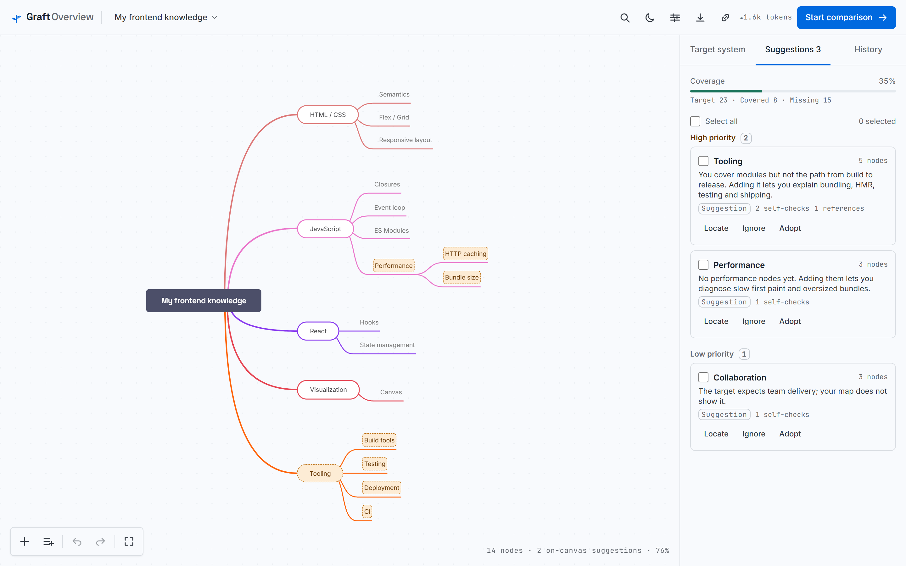
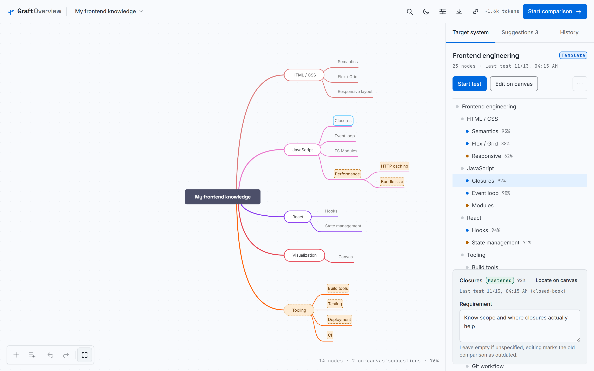
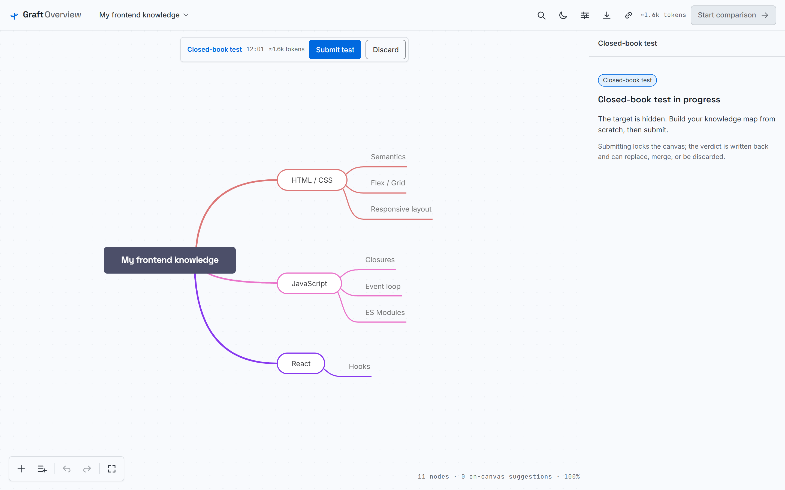
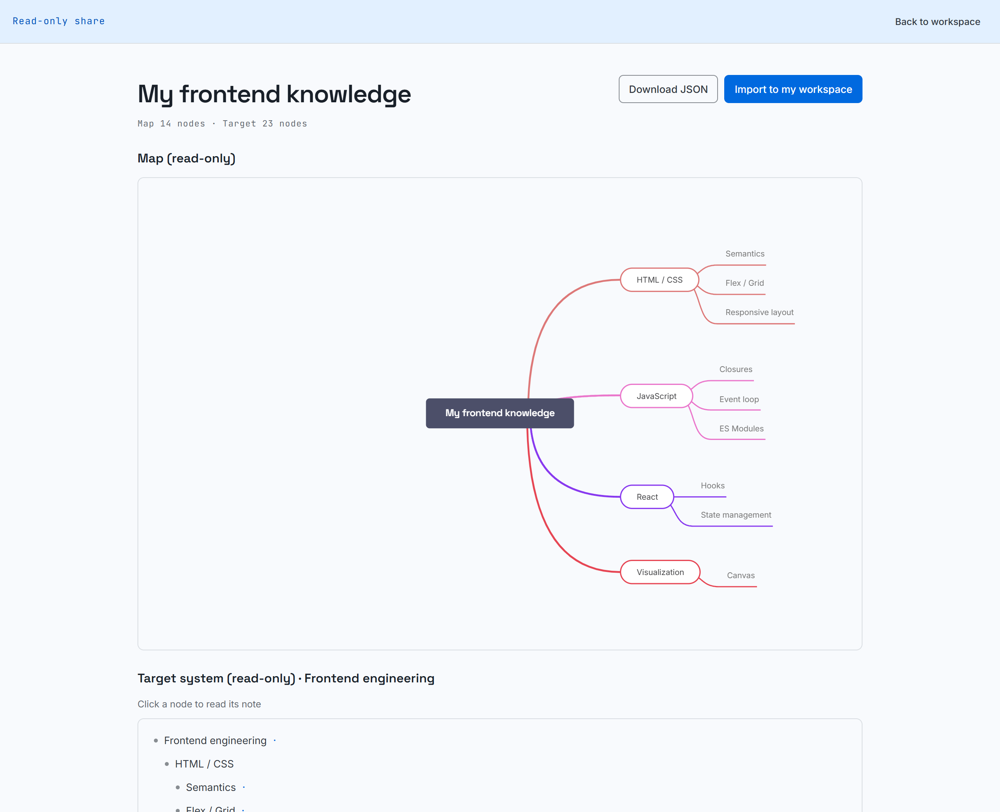
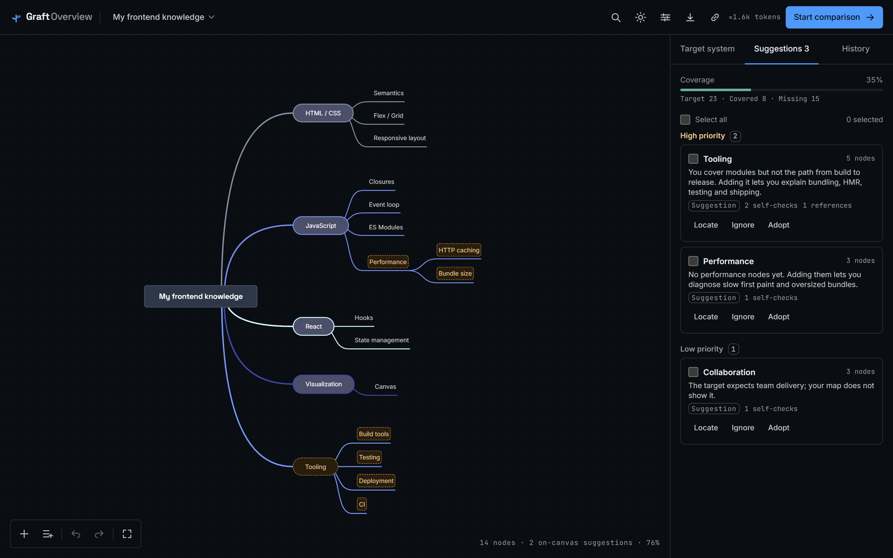

<p align="center">
  
</p>

<h1 align="center">GraftOverview</h1>

<p align="center">
  <strong>Draw what you know. See what you're missing.</strong><br>
  An open-source, browser-only tool that grafts a target knowledge system onto your mind map.<br>
  An LLM compares the two node by node, and every gap becomes a dashed ghost node on your canvas.
</p>

<p align="center">
  <a href="LICENSE"></a>
  
  
  
  <a href="README.md"></a>
</p>

<p align="center">
  
</p>

<p align="center">
  <sub>Solid lines are what you already mapped. Dashed nodes are what the target expects and you don't have yet — one click grafts the whole subtree in.</sub>
</p>

---

## The problem

Most knowledge maps record what you have learned. Very few answer what you are still missing.

GraftOverview works the other way around. Start from a **target system** — a built-in template, a Markdown outline, or one the model generates from your goal — then let an LLM compare it with your map. Gaps are not paragraphs in a report; they are dashed nodes attached to your own map, with a position, a parent and a priority. Adopting or ignoring one is a single click.

No account, no server, no telemetry. The model runs on your own key, straight from the browser.

## Screenshots

<table>
  <tr>
    <td width="50%" valign="top">
      
      <br><sub><b>Target system</b> — the target tree with requirements, mastery state and the last test; selecting a node locates it on the canvas.</sub>
    </td>
    <td width="50%" valign="top">
      
      <br><sub><b>Closed-book test</b> — the target is hidden; rebuild it from scratch, submit, and get every node marked unlearned, learning or mastered.</sub>
    </td>
  </tr>
  <tr>
    <td width="50%" valign="top">
      
      <br><sub><b>Read-only share</b> — map and target packed into one URL. No install, no key, nothing written to the visitor's storage.</sub>
    </td>
    <td width="50%" valign="top">
      
      <br><sub><b>Dark mode</b> — cool-white drafting paper and graphite, following the system or set by hand.</sub>
    </td>
  </tr>
</table>

<sub>Numbers and coverage in the screenshots are interface samples, not product metrics.</sub>

## Three steps

1. **Set the target** — pick one of eight templates, paste a Markdown outline, or describe your goal and let the model draft a target tree with per-node requirements. Restructure it later directly on the canvas.
2. **Compare** — your map stays as it is; the side panel shows coverage, gaps grouped by priority, and the extras the target does not cover. Large targets are split by top-level branch and failed branches can be retried on their own.
3. **Graft** — adopting a suggestion inserts the whole target subtree and drops the ghost styling; ignoring is undoable. When you want proof you actually know it, start a closed-book test.

## Features

|                       |                                                                                                                                                                                   |
| --------------------- | --------------------------------------------------------------------------------------------------------------------------------------------------------------------------------- |
| **Target system**     | Eight built-in templates, community packs (`.graftpack.json`) import/export, AI generation, manual outline, Markdown import; notes and self-check questions per node.             |
| **Map workbench**     | mind-elixir under the hood: add, edit, remove, fold, drag to pan, zoom, keyboard shortcuts, 50-step undo, autosave.                                                               |
| **Comparison engine** | BYOK, JSON validation with one repair pass, readable error mapping; targets over 400 nodes are chunked by top-level branch.                                                       |
| **Token estimates**   | Every compare / generate / test button shows an estimate computed from the real prompt; unchanged content reuses the last result instead of calling the model.                    |
| **Closed-book test**  | Target hidden, rebuild against a running clock, submission locks the attempt; the result can replace, merge into or discard your map, and writes mastery back to the target tree. |
| **Suggestions**       | Dashed ghost nodes, a suggestion panel, whole-subtree adoption, undoable ignores, coverage, and a diff against the previous comparison.                                           |
| **Take it with you**  | Per-workspace storage, JSON import/export, Markdown reports, and read-only share links (read-only canvas plus an expandable target tree).                                         |
| **App shell**         | Three-pane layout, command palette (⌘K), first-run tour, empty/error/loading states, full Chinese and English, dark mode, mobile layout.                                          |

## Getting started

Requires **Node.js ≥ 22.12** and **pnpm 10** (via corepack).

```bash
corepack enable
pnpm install
pnpm dev
```

| Command         | What it does                                                    |
| --------------- | --------------------------------------------------------------- |
| `pnpm dev`      | Local dev server                                                |
| `pnpm check`    | svelte-check, zero errors and zero warnings                     |
| `pnpm lint`     | ESLint                                                          |
| `pnpm test`     | Vitest unit tests                                               |
| `pnpm test:e2e` | Playwright end-to-end tests, including axe accessibility checks |
| `pnpm build`    | Build to `dist/`                                                |
| `pnpm preview`  | Preview the production build                                    |

The build is plain static files. `vite.config.ts` sets `base: './'` and routing is hash-based, so it deploys to GitHub Pages or any static host as is.

## Bring your own model

Open **Settings**, pick a preset (OpenAI / DeepSeek / SiliconFlow / Ollama / custom), then set the base URL, model, API key, temperature, max tokens and JSON mode.

- The key lives in `graft.llm.v1` on your machine and only travels in the `POST {baseUrl}/chat/completions` request your browser sends.
- Direct browser calls depend on the provider's CORS policy. If a provider blocks you, a local Ollama (`http://localhost:11434/v1`) has no such restriction.
- Presets are defaults only. Model names change; check the provider's docs.

## Privacy

- Data stays in `localStorage`: no account, no server, no telemetry, no third-party scripts.
- Before the first comparison you are told, explicitly, that your map and target will be sent to the provider you configured.
- The API key never enters a workspace, an export, a share link, history or a URL.
- Fonts are self-hosted; Chinese falls back to system fonts.
- You can clear the key and all workspaces at any time.

See [docs/privacy.md](docs/privacy.md).

## Stack

Svelte 5 (runes), TypeScript, Vite, Tailwind v4 and mind-elixir. All state and storage are local — no backend, no database, no external service at runtime.

The interface follows the Cobalt application variant: cool-white drafting paper, electric cobalt, Space Grotesk + Inter + JetBrains Mono. Every color, space and type size lives in the token layer in `src/app.css`; components never hardcode colors. The app mark is a sprout: the **solid leaf** is what you have mastered, the **dashed hollow leaf** is the gap.

Quality baseline: `pnpm check` clean, ESLint clean, 233 unit tests, 57 Playwright E2E tests, and no serious or critical axe findings.

## Roadmap

| Version   | Contents                                                                                                                           |
| --------- | ---------------------------------------------------------------------------------------------------------------------------------- |
| **v0.1**  | Targets, map, comparison, suggestions, export, mobile layout, i18n skeleton.                                                       |
| **v0.2**  | Target node details, branch-level comparison, resumable chunks, comparison diff, eight templates, command palette, first-run tour. |
| **v0.3**  | Multiple workspaces, template packs and contribution spec, richer read-only share, token estimates and a token-saving mode.        |
| **v0.4**  | Target editing on the canvas, closed-book tests, mastery projection (implemented, unreleased).                                     |
| **Later** | Side-by-side models, PDF / PNG export, PWA offline, optional worker proxy template.                                                |

## Docs

| Document                                                       | Contents                                                         |
| -------------------------------------------------------------- | ---------------------------------------------------------------- |
| [init.md](init.md)                                             | Product and data contract (§0–§8); the implementation follows it |
| [docs/integration.md](docs/integration.md)                     | Module boundaries and integration notes                          |
| [docs/design-target-session.md](docs/design-target-session.md) | v0.4 target editing and closed-book test design                  |
| [docs/template-pack-spec.md](docs/template-pack-spec.md)       | Community template pack format and contribution rules            |
| [docs/privacy.md](docs/privacy.md)                             | Data flow and privacy                                            |
| [docs/qa-report.md](docs/qa-report.md)                         | Defect log and how each fix was verified                         |

## Contributing

- Commit messages in English, UI copy through i18n (zh/en keys must stay in sync), no fake data, no backend.
- Contract changes start as `docs/contract-requests/<agent>-<YYYYMMDD>.md`.
- Before pushing, run `pnpm check && pnpm lint && pnpm test`; interaction changes need an E2E case.

## License

[MIT](LICENSE)

<p align="center">
  <sub><a href="README.md">中文 README</a> · Made for people who would rather see the gap than read about it.</sub>
</p>
