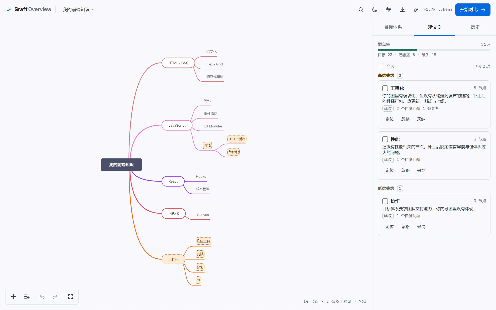
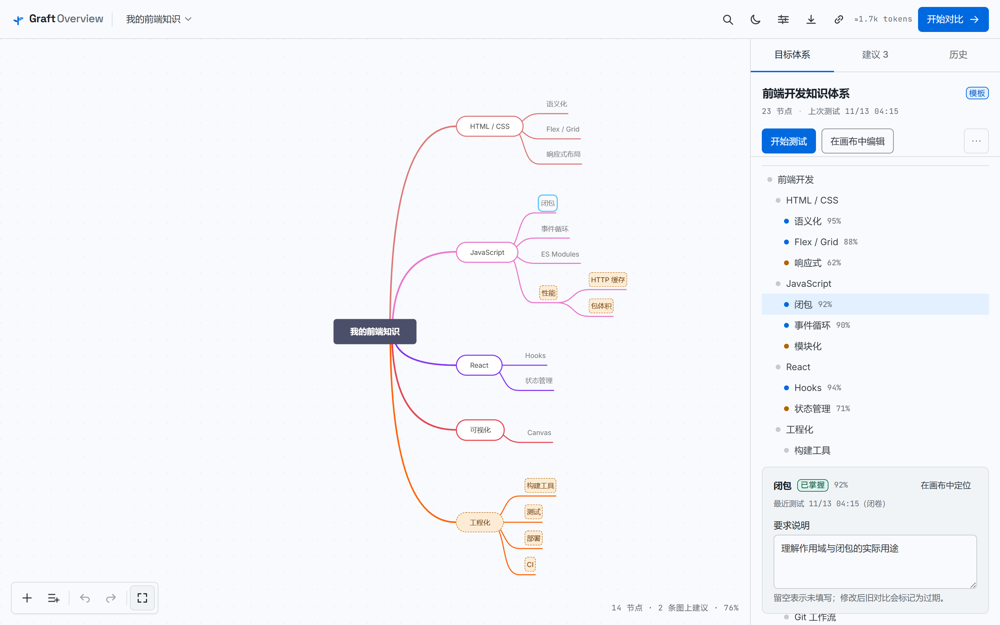
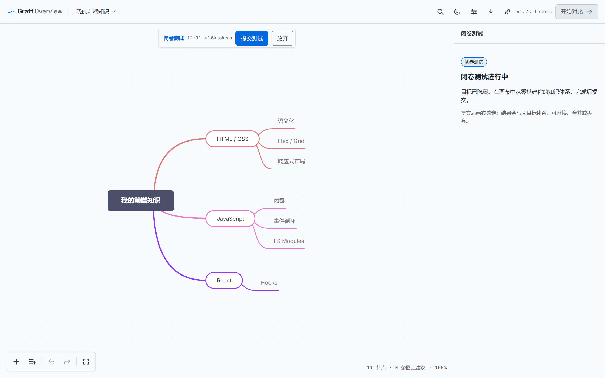
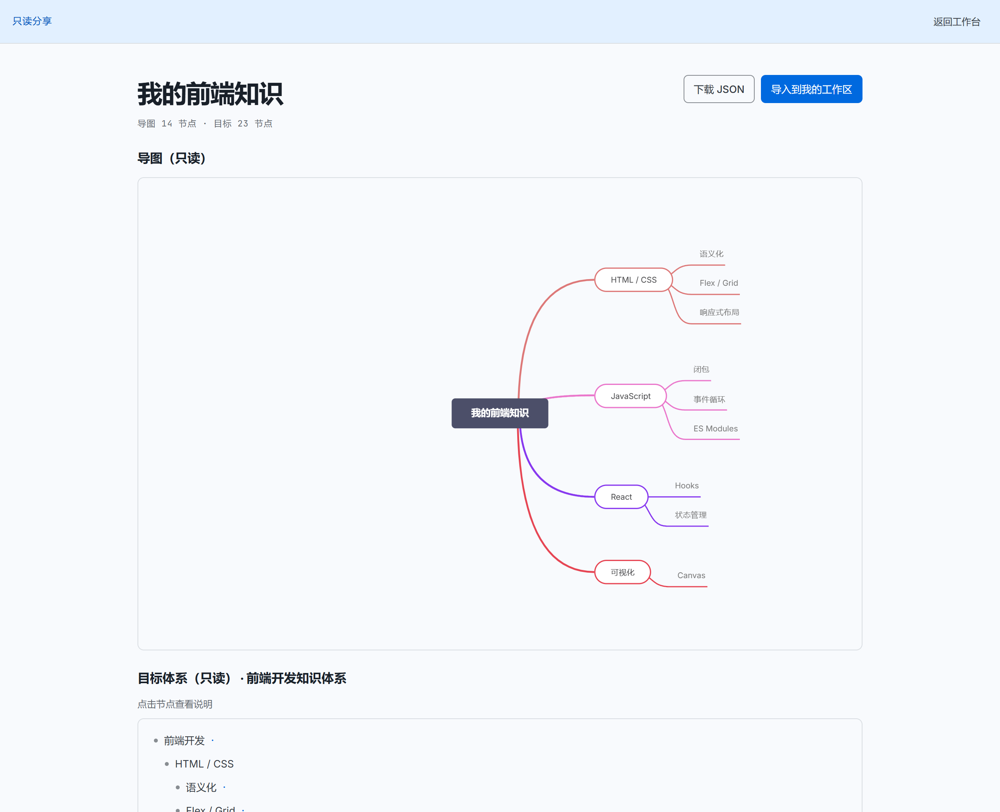
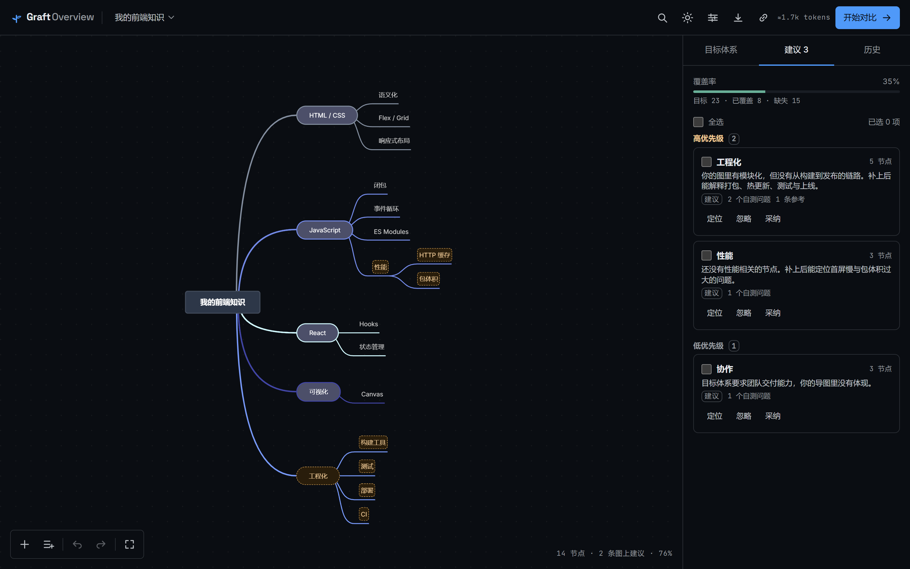

<p align="center">
  
</p>

<h1 align="center">GraftOverview</h1>

<p align="center">
  <strong>画出你会的，看见你缺的。</strong><br>
  纯前端、开源的知识体系「嫁接」工具：把目标体系与自己的导图做节点级语义比对，<br>
  缺口以虚线幽灵节点直接落在画布上，逐条采纳，直到两张图长成一张。
</p>

<p align="center">
  <a href="LICENSE"></a>
  
  
  
  <a href="README.en.md"></a>
</p>

<p align="center">
  
</p>

<p align="center">
  <sub>实线是你已经画下的，虚线是目标里有、你还没有的。点一下虚线就能把整棵子树嫁接进来。</sub>
</p>

---

## 它解决什么

大多数知识地图只记录「我学了什么」，不回答「我还差什么」。

GraftOverview 反过来做：先有一份**目标体系**（内置模板、Markdown 大纲、或让模型按你的目标生成），再把你的导图交给 LLM 做语义比对。缺口不是一段报告里的文字，而是长在你导图上的虚线节点——位置、层级、优先级都在，采纳或忽略都是一次点击。

没有账号、没有服务器、没有遥测。模型走你自己的 Key，从浏览器直接请求。

## 截图

<table>
  <tr>
    <td width="50%" valign="top">
      
      <br><sub><b>目标体系</b> — 树形目标、节点要求、掌握度与最近一次测试时间；选中即在画布上定位。</sub>
    </td>
    <td width="50%" valign="top">
      
      <br><sub><b>闭卷测试</b> — 目标隐藏，从零搭一遍；提交后由模型判定并写回「未学 / 学习中 / 已掌握」。</sub>
    </td>
  </tr>
  <tr>
    <td width="50%" valign="top">
      
      <br><sub><b>只读分享</b> — 导图与目标树打包进一条 URL，对方无需安装、无需 Key。</sub>
    </td>
    <td width="50%" valign="top">
      
      <br><sub><b>深色模式</b> — 冷白工程纸与石墨两套主题，跟随系统也可手动切换。</sub>
    </td>
  </tr>
</table>

<sub>截图中的数据与覆盖率均为界面样例，不是产品指标。</sub>

## 三步

1. **立目标** — 选一套内置模板、粘贴 Markdown 大纲，或描述你的方向让模型生成一棵带要求说明的目标树；之后可以在画布上直接改结构、补备注。
2. **对比** — 画布保留你原来的导图，右侧给出覆盖率、优先级分组的缺口建议与「额外掌握」；大目标自动按顶层分支分段对比，失败的分支可以单独续跑。
3. **补全** — 采纳会把整棵目标子树接进你的导图并去掉虚线与缺口标记；忽略可撤销。想验证是否真的学会，就开一次闭卷测试。

## 功能

|                |                                                                                                                   |
| -------------- | ----------------------------------------------------------------------------------------------------------------- |
| **目标体系**   | 8 套内置模板、社区模板包导入导出（`.graftpack.json`）、AI 生成、手动大纲、Markdown 导入；节点可写要求与自测问题。 |
| **导图工作台** | 基于 mind-elixir：增删改、折叠、拖拽平移缩放、快捷键、50 步撤销重做、自动保存。                                   |
| **对比引擎**   | BYOK、JSON 校验与一次修复、错误映射到可读提示；超过 400 节点自动分段，按顶层分支并行对比。                        |
| **Token 预估** | 对比、生成目标、测试连接的按钮旁按真实 Prompt 估算 token；内容未变化时复用上次结果，不再调用模型。                |
| **闭卷测试**   | 隐藏目标、计时搭建、提交锁定；结果可替换、合并或丢弃原导图，并把掌握度写回目标树。                                |
| **建议与补全** | 虚线幽灵节点、建议面板、整棵子树采纳、忽略可撤销、覆盖率、与上一次对比的差异回看。                                |
| **带走与分享** | 按工作区独立存储、JSON 导入导出、Markdown 报告、URL 只读分享（只读画布 + 可展开目标树）。                         |
| **应用外壳**   | 三栏布局、命令面板（⌘K）、首跑引导、空/错/加载状态、完整中英文、深色模式、移动端可用。                            |

## 快速开始

需要 **Node.js ≥ 22.12** 与 **pnpm 10**（通过 corepack 启用）。

```bash
corepack enable
pnpm install
pnpm dev
```

| 命令            | 作用                                       |
| --------------- | ------------------------------------------ |
| `pnpm dev`      | 本地开发服务器                             |
| `pnpm check`    | svelte-check，零错误零警告                 |
| `pnpm lint`     | ESLint                                     |
| `pnpm test`     | Vitest 单元测试                            |
| `pnpm test:e2e` | Playwright 端到端测试（含 axe 无障碍检查） |
| `pnpm build`    | 产物输出到 `dist/`                         |
| `pnpm preview`  | 预览构建产物                               |

构建结果是纯静态文件，`vite.config.ts` 设了 `base: './'`，路由走 hash，可直接部署到 GitHub Pages 或任意静态托管。

## 接入模型

打开右上角「设置」，选一个预设（OpenAI / DeepSeek / SiliconFlow / Ollama / 自定义），再填 Base URL、模型名、API Key、温度、最大输出与 JSON 模式。

- Key 只保存在本机 `graft.llm.v1`，只出现在你浏览器发出的 `POST {baseUrl}/chat/completions` 请求里。
- 浏览器直连受服务商 CORS 策略影响。被跨域拦住时，用本地 Ollama（`http://localhost:11434/v1`）不受限制。
- 预设只是默认值，模型名会变，请按服务商文档填写。

## 隐私

- 数据只存在本机浏览器的 `localStorage`：没有账号、没有服务器、没有遥测、不加载第三方脚本。
- 首次对比前会明确提示：你的导图与目标体系将发送给你配置的模型服务商。
- API Key 不会进入工作区、导出文件、分享链接、历史记录或 URL。
- 字体自托管，中文走系统字体回退。
- 可随时清除 Key 与工作区数据。

详见 [docs/privacy.md](docs/privacy.md)。

## 技术栈

Svelte 5（runes）+ TypeScript + Vite + Tailwind v4 + mind-elixir；状态与存储全部本地，无后端、无数据库、无运行时依赖外部服务。

界面遵循 Cobalt 应用变体设计系统：冷白工程纸、电光钴蓝、Space Grotesk + Inter + JetBrains Mono。所有颜色、间距、字号收敛在 `src/app.css` 的 token 里，组件不写裸色值。应用标记是一株芽：左下**实心叶**代表已掌握，右上**虚线空叶**代表缺口。

质量基线：`pnpm check` 零错误零警告、ESLint 通过、233 个单元测试、57 条 Playwright E2E、axe 无严重或致命问题。

## 路线图

| 版本     | 内容                                                                             |
| -------- | -------------------------------------------------------------------------------- |
| **v0.1** | 目标、导图、对比、建议、导出、移动端可用、i18n 骨架。                            |
| **v0.2** | 目标节点详情、分支级对比、分段续跑、多轮差异回看、8 套模板、命令面板、首跑引导。 |
| **v0.3** | 多工作区、模板包导入导出与贡献规范、只读分享增强、Token 预估与省 Token 模式。    |
| **v0.4** | 目标体系画布编辑、闭卷测试、掌握度投影（已完成，待发版）。                       |
| **之后** | 多模型并排、PDF / PNG 导出、PWA 离线、可选 Worker 代理模板。                     |

## 文档

| 文档                                                           | 内容                                  |
| -------------------------------------------------------------- | ------------------------------------- |
| [init.md](init.md)                                             | 产品与数据契约（§0–§8），实现以它为准 |
| [docs/integration.md](docs/integration.md)                     | 模块边界与集成说明                    |
| [docs/design-target-session.md](docs/design-target-session.md) | v0.4 目标编辑与闭卷测试设计           |
| [docs/template-pack-spec.md](docs/template-pack-spec.md)       | 社区模板包格式与贡献规范              |
| [docs/privacy.md](docs/privacy.md)                             | 数据流向与隐私说明                    |
| [docs/qa-report.md](docs/qa-report.md)                         | 逐项缺陷记录与验证方式                |

## 贡献

- 提交信息用英文，界面文案走 i18n（中英 key 必须对齐），不写假数据，不引入后端。
- 契约变更先写 `docs/contract-requests/<agent>-<YYYYMMDD>.md`。
- 提交前跑 `pnpm check && pnpm lint && pnpm test`，涉及交互的改动补一条 E2E。

## 许可证

[MIT](LICENSE)

<p align="center">
  <sub><a href="README.en.md">English README</a> · Made for people who would rather see the gap than read about it.</sub>
</p>
